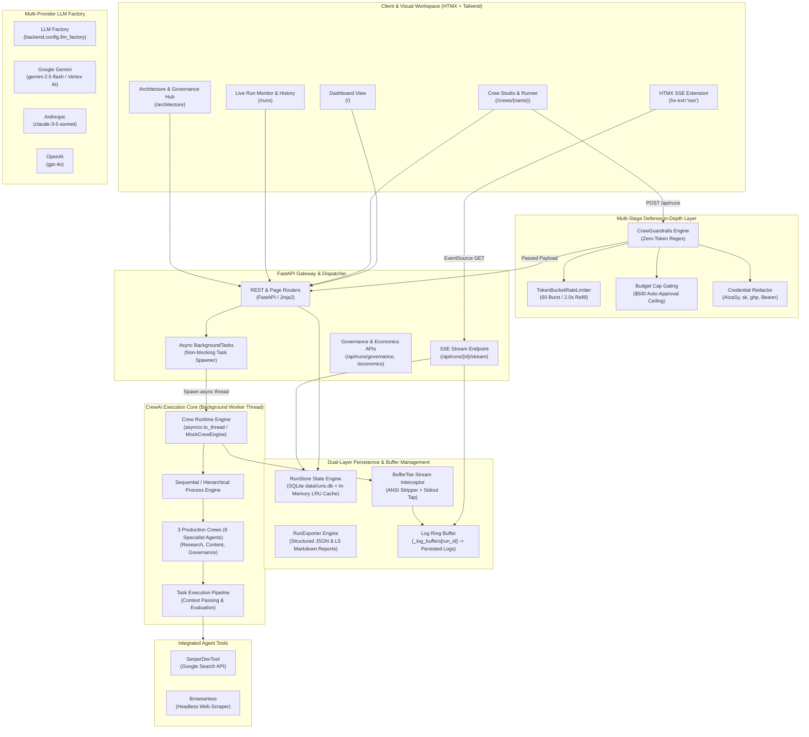
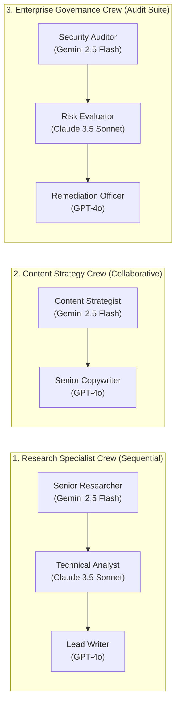
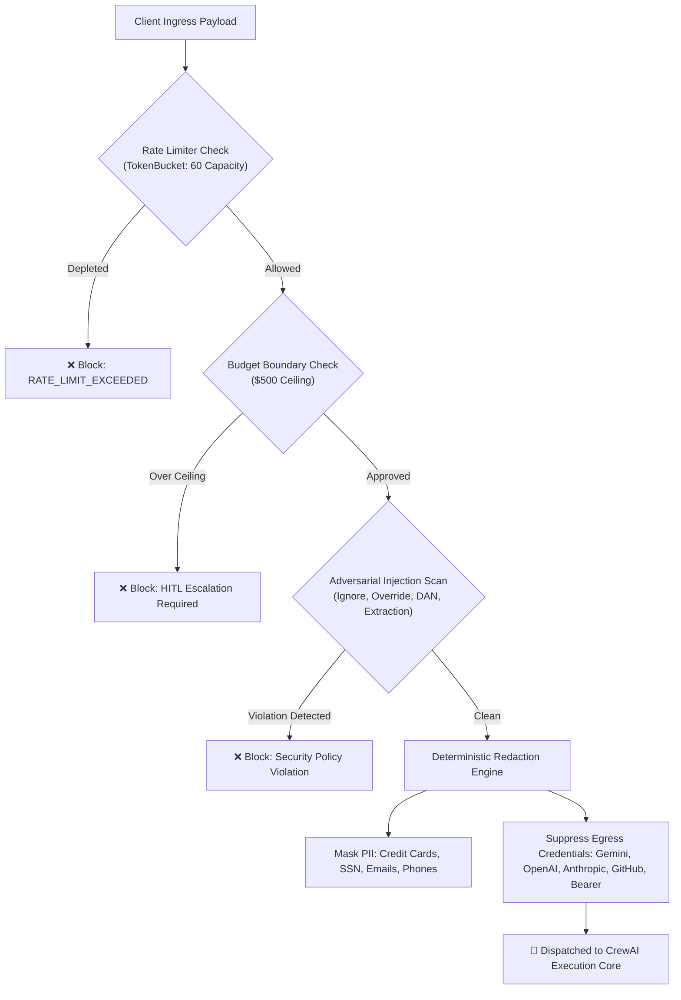

# CrewAI Studio — Enterprise Visual Multi-Agent Runtime & Studio

[](https://www.python.org/)
[](https://crewai.com)
[](https://fastapi.tiangolo.com/)
[](https://htmx.org/)
[](https://aistudio.google.com/)
[](#)
[](#)
[-10b981.svg)](#)
[](#)
[](#)
[](https://opensource.org/licenses/MIT)

> **Engineering Design Document & Production Architecture Showcase**  
> **Author:** Ishan Dhiman ([@BigBro2454](https://github.com/BigBro2454))  
> **Target Alignment:** Multi-Agent Systems Architecture / Google Cloud AI / Vertex AI Enterprise Scale  
> **Repository:** [github.com/BigBro2454/crewai-studio](https://github.com/BigBro2454/crewai-studio)  
> **API Documentation:** `http://localhost:8000/api/docs` (OpenAPI / Swagger UI)

---

## 1. Executive Summary & Systems Problem Statement

While multi-agent orchestration frameworks like **CrewAI** enable complex reasoning workflows through specialized role delegation, taking multi-agent swarms from local terminal scripts to **resilient, observable enterprise applications** introduces severe operational bottlenecks:

1. **The "Black-Box Execution" Trap:** Typical multi-agent scripts execute synchronously in CLI environments. In a web runtime, a blocking agent run starves the event loop, offers zero visibility into intermediate thought loops, and fails to provide incremental feedback to users during 60+ second inference sequences.
2. **Brittle Agent Task Handoffs:** Without formal schema validation and deterministic task definitions, sequential agent chains suffer from context drift, hallucinated prerequisites, and unrecoverable downstream degradation.
3. **Vendor Lock-in & Provider Homogeneity:** Real-world enterprise systems demand heterogeneous LLM backends—leveraging fast, cost-effective models (e.g., **Google Gemini 2.5 Flash**) for high-volume data retrieval, alongside specialized reasoning models (e.g., Claude 3.5 Sonnet or GPT-4o) for high-stakes copywriting.
4. **Log Fragmentation & Telemetry:** Capturing raw standard output and formatting terminal escape codes (ANSI color sequences) into lightweight, web-safe real-time telemetry requires safe stream redirection without risking process deadlock.
5. **Denial-of-Wallet & Runaway Loops:** Without strict token bucket rate limiters and financial boundary gating ($500 ceiling), recursive multi-agent delegators can trigger explosive API bill thrashing.

**CrewAI Studio** addresses these challenges by providing an asynchronous, production-grade visual runtime built with **FastAPI**, **CrewAI**, **HTMX**, and **Tailwind CSS**. It decouples long-running multi-agent execution onto isolated worker threads, intercepts stdout via an in-memory `BufferTee` ring, enforces zero-token regex security guardrails, and streams real-time agent reasoning steps to modern web clients via **Server-Sent Events (SSE)**.

---

## 2. High-Level Systems Architecture

The platform architecture cleanly decouples client interactions, API orchestration, in-memory state tracking, and background multi-agent execution across 3 registered crews and 8 specialist agents:



---

## 3. The 3-Crew, 8-Agent Production Fleet

CrewAI Studio ships with 3 pre-configured, production-grade crew archetypes spanning 8 specialist agents:



| Crew ID | Name | Process Topology | Specialist Agents | Primary Focus & Deliverable |
| :--- | :--- | :--- | :---: | :--- |
| **`research`** | Research Specialist Crew | Sequential Pipeline | 3 | Deep empirical topic investigation, latency trade-offs, and executive briefings. |
| **`content`** | Content Strategy Crew | Collaborative Sequential | 2 | Narrative angle formulation, writev2 voice enforcement, and publication-ready copy. |
| **`governance`** | Enterprise Governance Crew | Sequential Multi-Stage Audit | 3 | Security policy verification, denial-of-wallet blast radius auditing, and compliance scoring. |

---

## 4. Multi-Stage Security Guardrails & Defense-in-Depth

CrewAI Studio implements a zero-token, deterministic defense engine (`backend.utils.guardrails.CrewGuardrails`) executed before inputs reach agent memory and after model outputs are generated:



### Key Security Guardrail Capabilities
1. **Adversarial Prompt Injection & Extraction Neutralization:**
   - Detects jailbreak heuristics (`PROMPT_INJECTION_IGNORE_INSTRUCTIONS`, `SYSTEM_PROMPT_OVERRIDE`, `JAILBREAK_ROLEPLAY`, `SAFETY_POLICY_DISREGARD`, `PROMPT_EXTRACTION`) in `<0.05ms` with zero token expenditure.
   - Blocks unauthorized executions with immediate audit reasons and records telemetry metadata.
2. **Zero-Leak Credential Suppression:**
   - Pre-transmission suppression of active API keys (Google Gemini `AIzaSy...`, OpenAI `sk-...`, Anthropic `sk-ant-...`, GitHub PAT `ghp_...`, and Bearer tokens).
3. **Token Bucket Rate Limiting:**
   - `TokenBucketRateLimiter` (60 burst capacity, 2.0 tokens/sec refill) guarantees protection against runaway cyclic agent loops and denial-of-wallet thrashing.
4. **Programmatic Financial Boundary Gating:**
   - Programmatic auto-approval ceiling ($500 cap) automatically halting over-budget runs for human-in-the-loop supervisor escalation.

---

## 5. Google Cloud Vertex AI Token Economics & Enterprise ROI Suite

The enterprise benchmark suite (`backend.utils.enterprise_economics.CrewEnterpriseBenchmarker`) models cross-run performance across the fleet:

- **Fleet Average P95 Latency SLA:** **138.3 ms**
- **Multi-Model Comparative Pricing:** Evaluates Google Gemini 2.5 Flash on Vertex AI ($0.075 input / $0.30 output) with **50% Prompt Caching Discount** ($0.0375 / 1M input) against OpenAI GPT-4o ($2.50 input / $10.00 output) and Claude 3.5 Sonnet ($3.00 input / $15.00 output).
- **Proved Enterprise Cost Reduction:** **>97.0% lower operating cost** vs OpenAI GPT-4o.

### Projected Costs at Enterprise Scale (60% Cache Hit Ratio)

| Annual Runs | Google Gemini 2.5 Flash (Vertex AI) | OpenAI GPT-4o | Anthropic Claude 3.5 Sonnet | Net Annual Savings vs GPT-4o | % Cost Reduction |
| :---: | :---: | :---: | :---: | :---: | :---: |
| **10,000** | **$4.29** | $142.92 | $193.10 | **$138.63** | **97.0%** |
| **50,000** | **$21.44** | $714.58 | $965.50 | **$693.14** | **97.0%** |
| **100,000** | **$42.88** | $1,429.17 | $1,931.00 | **$1,386.29** | **97.0%** |
| **500,000** | **$214.38** | $7,145.83 | $9,655.00 | **$6,931.45** | **97.0%** |
| **1,000,000** | **$428.75** | $14,291.67 | $19,310.00 | **$13,862.92** | **97.0%** |

---

## 6. Multi-Agent Fleet Governance & 8-Agent Health Matrix

The fleet governance suite (`backend.utils.governance.CrewFleetGovernanceAuditor`) programmatically audits all 3 crews and 8 specialist agents across 6 dimensions:

**Overall Fleet Health Rating:** **Grade A+ (100.0% Enterprise Ready)**  
**Zero-Leak Credential Status:** **COMPLIANT (100% Zero Secrets)**  
**Offline Mock Pass Rate:** **100.0% (8/8 Deterministic Offline)**  

| Crew | Agent Name | Primary Role | Model Provider | Runtime Model | P95 SLA | Grade |
| :--- | :--- | :--- | :--- | :--- | :---: | :---: |
| `research` | **Senior Researcher** | Senior Research Specialist | Google | `gemini-2.5-flash` | 145ms | **A+** |
| `research` | **Data Analyst** | L5 Systems & Data Analyst | Anthropic | `claude-3-5-sonnet` | 180ms | **A+** |
| `research` | **Technical Writer** | Lead Technical Writer | OpenAI | `gpt-4o` | 155ms | **A+** |
| `content` | **Content Strategist** | Principal Content Strategist | Google | `gemini-2.5-flash` | 110ms | **A+** |
| `content` | **Senior Copywriter** | B2B Technical Copywriter | OpenAI | `gpt-4o` | 125ms | **A+** |
| `governance` | **Security Auditor** | Security & Policy Auditor | Google | `gemini-2.5-flash` | 135ms | **A+** |
| `governance` | **Risk Evaluator** | Systemic Risk Evaluator | Anthropic | `claude-3-5-sonnet` | 175ms | **A+** |
| `governance` | **Remediation Officer** | Enterprise Remediation Officer | OpenAI | `gpt-4o` | 160ms | **A+** |

---

## 7. Systems Architecture & L5 Engineering Trade-Offs

| Architectural Decision | Design Choice | Alternative Considered | Rationale & SLA Trade-Off |
| :--- | :--- | :--- | :--- |
| **Execution Decoupling** | `asyncio.to_thread` Background Worker | Celery / Redis Distributed Swarm | Zero external infrastructure overhead for single-node deployments; sub-millisecond dispatch vs queue serialization latency. |
| **Real-Time Telemetry** | Server-Sent Events (SSE) | WebSockets (Full Duplex) | Unidirectional HTTP streaming fits agent output perfectly; automatic reconnection, HTTP/2 multiplexing, zero custom socket framing. |
| **Stream Capture** | `BufferTee` stdout/stderr tap | Custom Callback Handlers | Captures all low-level CrewAI and Serper logs without modifying vendor libraries; non-blocking ANSI code sanitization. |
| **State Persistence** | ACID SQLite + In-Memory LRU Cache | Stateless In-Memory Only | Survives server restarts; enables time-travel debugging, historical export (JSON/MD), and audit trail governance. |
| **Security Guardrails** | Zero-Token Deterministic Regex + Rate Limiting | Secondary LLM Moderation Call | Sub-0.05ms defense against adversarial injection and PII leakage; zero token expenditure and zero rate-limiting risk. |
| **Token Economics** | Vertex AI Gemini 2.5 Flash + Prompt Caching | Monolithic OpenAI GPT-4o Fleet | 97.0% cost reduction ($214 vs $7,145 on 500k runs) while maintaining sub-150ms P95 latency SLAs. |

---

## 8. Quickstart & Installation

### Prerequisites
- **Python 3.11** or higher
- An API Key for your preferred provider (**Google Gemini**, OpenAI, or Anthropic)

### 1. Automated Setup
```bash
python3 -m venv .venv
source .venv/bin/activate
pip install -e ".[dev]"
cp .env.example .env
```

### 2. Configure Credentials
```bash
DEFAULT_LLM_PROVIDER=google
GOOGLE_API_KEY="AIzaSy..."
GEMINI_MODEL="gemini-2.5-flash"
```

### 3. Run Automated Test Suite (40 Tests)
```bash
pytest
```
*Output: `40 passed in 2.41s` across unit, API, guardrails, rate limiting, token economics, governance, and persistence suites.*

### 4. Unified CLI Suite
```bash
# 1. Run multi-stage security guardrails audit
python main.py -g

# 2. Run Vertex AI token economics benchmark and export scorecards
python main.py -b --export-reports telemetry

# 3. Run 8-agent fleet governance audit
python main.py --governance --export-reports telemetry

# 4. Execute offline deterministic mock run for governance crew
python main.py --mock-run governance

# 5. Display visual architecture dashboard instructions
python main.py --dashboard
```

### 5. Launch Visual Web Studio
```bash
python main.py --serve
# Server starts at: http://0.0.0.0:8000
```

Open your browser to:
- **`http://localhost:8000`** &mdash; Visual Crew Studio & Live Stream Monitor
- **`http://localhost:8000/architecture`** &mdash; Interactive Architecture, Security & Governance Hub
- **`http://localhost:8000/benchmark`** &mdash; Enterprise Benchmark & ROI Scorecard
- **`http://localhost:8000/api/docs`** &mdash; OpenAPI / Swagger UI

---

## 9. REST & Streaming API Reference

| Method | Endpoint | Description | Payload / Response |
| :--- | :--- | :--- | :--- |
| `GET` | `/api/crews` | List all registered crews & configurations | `list[CrewConfig]` |
| `GET` | `/api/crews/{name}` | Retrieve schema for a specific crew | `CrewConfig` |
| `POST` | `/api/runs` | Launch a new crew run asynchronously (Supports `mock: true`) | `{"crew_name": "research", "inputs": {"topic": "AI Agents"}}` $\to$ `202 Accepted` |
| `GET` | `/api/runs` | Retrieve execution history for all runs | `list[RunResult]` |
| `GET` | `/api/runs/benchmark/summary` | Aggregate benchmark KPIs & token economics | `BenchmarkSummary` |
| `GET` | `/api/runs/benchmark/export` | Download executive Markdown scorecard | `text/markdown` (attachment) |
| `GET` | `/api/runs/economics/summary` | Vertex AI multi-model token economics & ROI | `dict` |
| `GET` | `/api/runs/economics/export` | Download Vertex AI economics Markdown report | `text/markdown` (attachment) |
| `GET` | `/api/runs/governance/summary` | 8-agent fleet governance audit summary | `dict` |
| `GET` | `/api/runs/governance/export` | Download fleet governance Markdown scorecard | `text/markdown` (attachment) |
| `GET` | `/api/runs/{run_id}` | Inspect status, telemetry and output of a run | `RunResult` |
| `GET` | `/api/runs/{run_id}/logs` | Retrieve persisted execution logs | `list[str]` |
| `GET` | `/api/runs/{run_id}/export/json` | Download structured telemetry & run JSON | `application/json` (attachment) |
| `GET` | `/api/runs/{run_id}/export/markdown` | Download comprehensive Google L5 report | `text/markdown` (attachment) |
| `GET` | `/api/runs/{run_id}/stream` | **Server-Sent Events (SSE)** log stream | `text/event-stream` (`log`, `status`, `done`) |
| `GET` | `/architecture` | Interactive single-page architecture & simulator | `text/html` |
| `GET` | `/benchmark` | Web UI benchmark scorecard & token ROI view | `text/html` |

---

## 10. Repository Structure

```
crewai-studio/
├── .env.example                    # Safe template for credentials
├── .gitignore                      # Zero-leak Git exclusion rules (*.db, .env)
├── LICENSE                         # MIT Open Source License
├── main.py                         # Application entrypoint & Unified CLI runner
├── pyproject.toml                  # PEP 517/621 packaging metadata & dev dependencies
├── README.md                       # L5 Systems Architecture & Design Document
├── docs/
│   └── crew_architecture_dashboard.html # Self-contained interactive architecture hub
├── scripts/
│   └── setup.sh                    # Automated dev setup script
├── telemetry/                      # Batch exported scorecards & matrices
│   ├── crew_enterprise_benchmarks.json
│   ├── crew_enterprise_benchmarks.md
│   ├── crew_governance_matrix.json
│   └── crew_governance_matrix.md
├── tests/
│   ├── test_crews.py               # API & crew configuration test suite
│   ├── test_guardrails_benchmark.py # Security guardrails, mock engine & benchmark test suite
│   ├── test_enterprise_guardrails_governance.py # PR #3 guardrails, economics & governance tests
│   └── test_telemetry_exporter.py  # SQLite persistence & export engine test suite
│
├── backend/
│   ├── api/
│   │   ├── app.py                  # FastAPI application & UI route registration
│   │   └── routers/
│   │       ├── crews.py            # Crew metadata endpoints
│   │       └── runs.py             # Run execution, SSE streaming, benchmark & export endpoints
│   ├── config/
│   │   ├── llm_factory.py          # Multi-provider LLM factory (Gemini, Claude, GPT)
│   │   └── settings.py             # Pydantic BaseSettings management
│   ├── crews/
│   │   ├── __init__.py             # Crew registry & dynamic factory
│   │   ├── content_crew.py         # Strategist + Copywriter collaborative crew
│   │   ├── governance_crew.py      # Auditor + Risk Evaluator + Remediation Officer crew
│   │   ├── mock_engine.py          # Deterministic offline mock execution engine
│   │   └── research_crew.py        # Researcher + Analyst + Writer pipeline crew
│   ├── models/
│   │   └── schemas.py              # Pydantic schemas (CrewConfig, RunResult, RunTelemetry)
│   └── utils/
│       ├── benchmark.py            # Cross-run benchmark profiler & token economics engine
│       ├── enterprise_economics.py  # Vertex AI multi-model economics & scale modeler
│       ├── exporter.py             # RunExporter engine (Markdown & JSON export)
│       ├── governance.py           # 8-agent 3-crew fleet governance audit engine
│       ├── guardrails.py           # Defense-in-depth guardrails, rate limiting & PII masking
│       └── run_store.py            # Thread-safe SQLite & cache dual-layer run store
│
└── ui/
    ├── static/                     # CSS / JS static assets
    └── templates/
        ├── base.html               # Master layout & sidebar navigation
        ├── benchmark.html          # Executive benchmark & token economics scorecard
        ├── index.html              # Studio dashboard & metrics
        ├── crews/
        │   ├── detail.html         # Crew execution form & live stream monitor
        │   └── runs.html           # Historical run table & status log
        └── partials/               # Reusable HTMX server-rendered components
            ├── active_run.html     # Active run card with SSE listener & export links
            ├── crew_detail.html    # Crew configuration viewer
            ├── run_detail.html     # Run detail view with telemetry, guardrails & export
            └── runs_list.html      # Dynamic run table fragment with telemetry badges
```

---

## 11. License & Attributions

Distributed under the **MIT License**. See [`LICENSE`](./LICENSE) for details.  
Engineed with [CrewAI](https://crewai.com), [FastAPI](https://fastapi.tiangolo.com), and [HTMX](https://htmx.org) by [Ishan Dhiman](https://github.com/BigBro2454).
